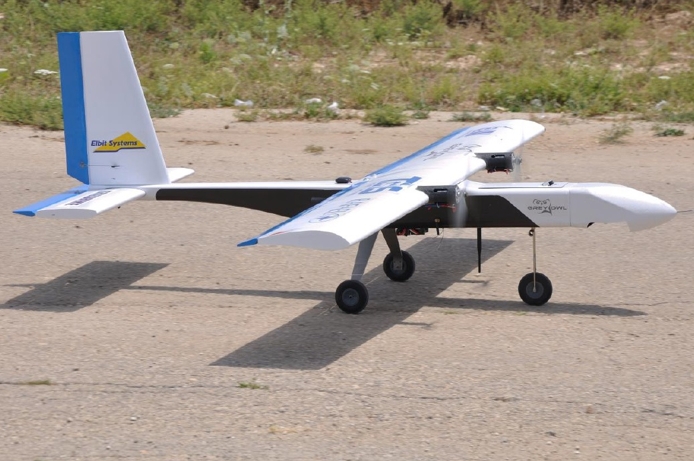

# AUVSI Seafarer 2014 GrayOwl Image Processing Team

The GrayOwl image-processing project developed ground-control and onboard vision systems to detect and identify targets from a student-built autonomous drone for the 2014 AUVSI Seafarer competition. This public repository contains project documentation and the original figure; source code and later implementations have been withdrawn.

Students: Li-tal Kupperman, Eli Hayoon, Nadav Ofir, Ziv Nachum, Itay Guy, Liat Katz.

Supervision: Aaron Wetzler.

*Historical figure from the archived project website, unchanged.*

## Links

- [Project entry on Aaron Wetzler's website](https://twerdster.github.io/#auvsi-seafarer-2014-grayowl-image-processing-team)
- [Team page](https://aerospace.technion.ac.il/projects/auvsi/)
- [Team report](https://aerospace.technion.ac.il/wp-content/uploads/2014/09/AUVSI-Journal-Paper.pdf)
- [Poster](https://www.dror-aero.com/ac/posterfinal.pdf)
- [Team video](https://www.youtube.com/watch?v=DFLy9aDjSd8)

## Attribution

The student and supervision credits are listed above. Project members can open an issue to correct attribution, add documentation or request removal of their material. These records do not grant a license to the linked materials.
